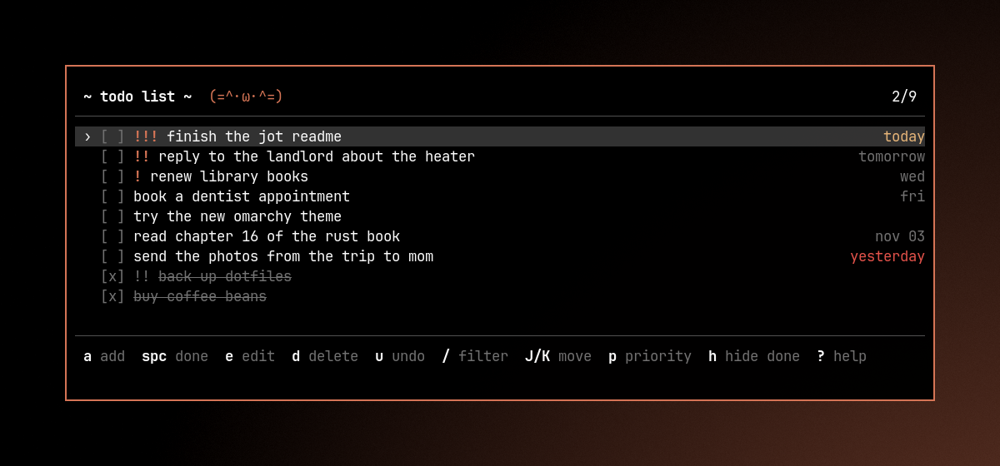

# ૮ ˶ᵔ ᵕ ᵔ˶ ა todoterm

a minimalist and aesthetic task manager for the terminal.

built with love in rust. one window, one list. fits perfectly into tiling window managers (and feels at home in [omarchy](https://omarchy.org)), with vim-like keys and zero visual noise.



## features

* vim-like keybinds, so your hands stay on the keyboard
* priorities and due dates right in the text: `buy milk !! @fri`
* edit, reorder, filter, hide finished tasks, undo / redo
* follows your terminal colors, or the current omarchy theme, and repaints live when you switch themes
* your tasks are saved after every change, atomically, so a crash can't leave half a file behind
* a broken `todo.json` is never overwritten: todoterm stops and tells you, and keeps a copy
* edits from outside (a second window, a sync tool) show up within a second

## install

### omarchy (recommended)

```sh
git clone https://github.com/gloomyweather/todoterm
cd todoterm
contrib/omarchy/install.sh
```

this builds todoterm, installs it to `~/.local/bin`, adds it to the launcher (super + space, search "todo") and, after asking, adds two things to your hyprland config:

* **super + alt + t** opens todoterm in a floating window, or focuses it if it's already open
* the window floats centered at omarchy's usual 875×600

the theme is picked up automatically, and the launcher icon recolors itself on every `omarchy theme set`. run `contrib/omarchy/install.sh --yes` to skip the question, `--no-hypr` to leave the hyprland config alone. `contrib/omarchy/uninstall.sh` removes everything again (your tasks stay).

### with cargo

you will need rust (get it from rustup.rs).

```sh
cargo install --git https://github.com/gloomyweather/todoterm
```

### prebuilt binary

grab `todoterm-<version>-x86_64-unknown-linux-gnu.tar.gz` from the [releases](https://github.com/gloomyweather/todoterm/releases), unpack it and either copy `todoterm` somewhere in your `PATH` or run `contrib/omarchy/install.sh` from the unpacked folder.

### arch / aur

`contrib/arch/PKGBUILD` builds a tagged release: `cd contrib/arch && makepkg -si`.

## keybinds

press `?` inside the app for the same list.

### normal mode

| key | action |
|---|---|
| `j` / `k`, `↓` / `↑` | move down / up |
| `g` / `G`, `home` / `end` | first / last task |
| `pgup` / `pgdn` | page up / down |
| `a` or `i` | add a task at the end |
| `o` / `O` | add a task below / above the current one |
| `e` or `r` | edit the current task |
| `space` or `enter` | mark done / undone |
| `d` or `x` | delete (no questions, `u` brings it back) |
| `J` / `K`, `shift+↓` / `shift+↑` | move the task down / up |
| `m` | move mode: `j`/`k` to move, `enter` or `esc` when done |
| `p` | cycle priority: none → `!` → `!!` → `!!!` |
| `/` | filter as you type; `enter` keeps it, `esc` clears it |
| `h` | hide / show finished tasks |
| `C` | clear all finished tasks |
| `u` / `ctrl+r` | undo / redo |
| `?` | help |
| `q`, `esc` or `ctrl+c` | quit (`esc` clears an active filter first) |

normal-mode keys also work on a russian layout, no need to switch.

### while typing

| key | action |
|---|---|
| `enter` | save |
| `esc` or `ctrl+c` | cancel |
| `←` / `→`, `home` / `end`, `ctrl+a` / `ctrl+e` | move the cursor |
| `ctrl+w` | delete the word before the cursor |
| `ctrl+u` | delete everything before the cursor |
| `backspace` / `delete` | delete a character |

pasting works too, line breaks become spaces.

## inline syntax

when adding or editing, a few tokens are pulled out of the text:

| token | meaning |
|---|---|
| `!` `!!` `!!!` | priority |
| `@today`, `@tom` / `@tomorrow` | due today / tomorrow |
| `@mon` … `@sun` | the next such day (never today) |
| `@+3d`, `@+2w` | in 3 days, in 2 weeks |
| `@2026-11-01`, `@11-01` | a date (`@11-01` means the next nov 1) |

`call mom !! @fri` becomes "call mom" with priority 2, due friday. anything else starting with `@` stays part of the text. due dates show on the right: red when overdue, yellow for today.

## where your tasks live

todoterm picks the first of:

1. `--file <path>`
2. the `TODOTERM_FILE` environment variable
3. `file` in the config
4. `./todo.json`, if it exists in the current folder
5. `~/.local/share/todoterm/todo.json` (`$XDG_DATA_HOME`), created on first save

**coming from 0.1?** 0.1 always used `./todo.json` in the folder you started it from, and that file is still picked up when you run todoterm there. to make it your global list, move it: `mkdir -p ~/.local/share/todoterm && mv todo.json ~/.local/share/todoterm/`. the format is the same; new fields are only added when you use them.

## config

optional, at `~/.config/todoterm/config.toml` (or `--config <path>`). everything has a default:

```toml
# file = "~/notes/todo.json"
kaomoji = true        # the little faces in the title
hide_done = false     # start with finished tasks hidden
theme = "auto"        # "auto" | "omarchy" | "terminal"

# [colors]            # override any theme color: "#rrggbb" or a name like "red"
# accent = "#d97757"
# muted = "darkgray"
# selection = "#333333"
# fg, selection_fg, danger, warning, success, border also work
```

`auto` and `omarchy` use the current omarchy theme (`~/.local/state/omarchy/current/theme/colors.toml`) when there is one and fall back to your terminal's colors otherwise. `terminal` always uses the terminal's colors. the background is never painted, so transparency keeps working.

## license

[gpl-3.0](LICENSE)

may your tasks always be organized (=^･ω･^=)
